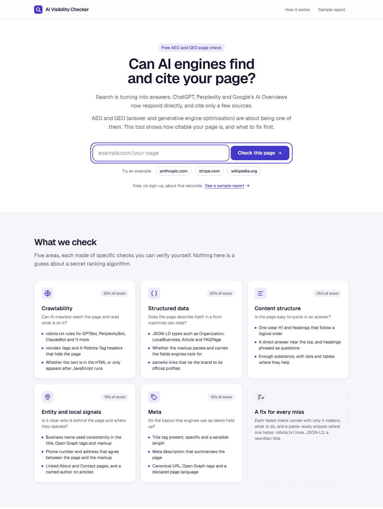
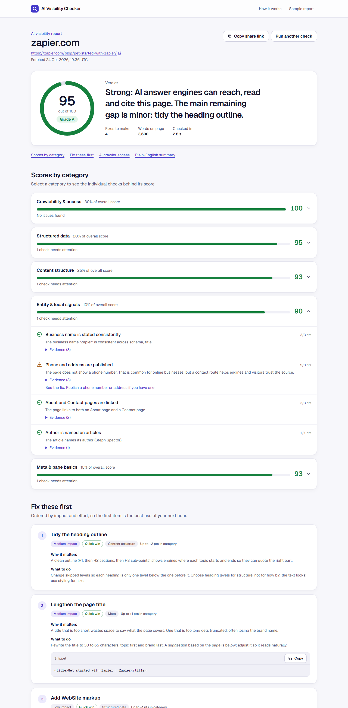
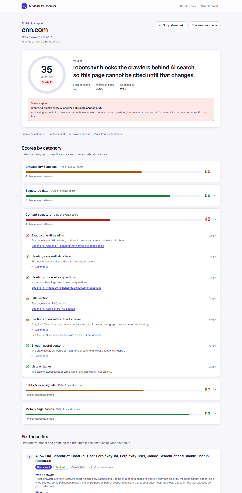
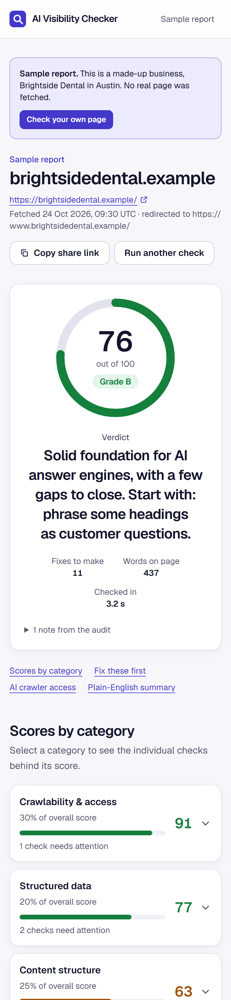

# AI Visibility Checker

Paste a web address and find out how likely ChatGPT, Perplexity, Google's AI Overviews and Claude are to find and cite that page. You get a score out of 100, a score for each of five areas, and a ranked list of fixes with snippets you can paste in.



## The problem

More and more searches end in an answer, not a list of links. Someone asks Perplexity which CRM suits a ten-person agency, gets a paragraph back, and the three or four sources it cites are the only brands that got a look in. In marketing this is starting to be called AEO (answer engine optimisation) or GEO (generative engine optimisation). The work overlaps with SEO, but the failure modes are different, and most of the free SEO audit tools I tried don't look at them at all.

Three examples from testing this tool on 25 October 2026:

- The Guardian's robots.txt blocks PerplexityBot and Anthropic's search crawler but not OpenAI's. The BBC blocks OpenAI's and Perplexity's answer bots but lets Anthropic's through. So the same story can be quotable in one AI engine and invisible in another, and that decision sits in a text file most marketers have never opened.
- Excalidraw's home page arrives as an empty app shell. The text only appears after JavaScript runs, and most AI crawlers don't run JavaScript, so they see a page with nothing to quote.
- Anthropic's home page has no structured data at all (no JSON-LD block of any kind), on a site that is otherwise well built.

None of these show up in a normal "is my title tag too long" audit. That gap is what this tool is for.

## Who it's for, and why it's built like a lead magnet

The target user is a marketer or founder at a small or mid-sized business who has heard "you need to show up in ChatGPT" and has no way to check. So the tool is shaped like the free audits growth teams use for lead generation:

- **No sign-up to see the full report.** Asking for an email before showing the score gets more emails and less trust. I'd rather the report be good enough that people share it.
- **A shareable URL for every report** (`/report?url=example.com`), so a marketer can drop the link in Slack and their developer sees the same fixes.
- **The ask comes after the value.** At the bottom of the report there's a "re-check this monthly" email box, which is the natural next step once someone has seen their score. In v1 it's honest about being a demo and stores nothing. It's a separate component so it can be wired to a CRM.
- **Copy that doesn't oversell.** The page says plainly that the score estimates citability from on-page signals and can't promise anyone a place in an answer. AEO is new enough that most claims about it are guesses, and a tool that overpromises loses the people who know that.

## What it checks

Five weighted areas and 29 individual checks, all rule-based, so every result can be checked by hand.

| Area | Weight | Examples of what it looks at |
| --- | --- | --- |
| Crawlability and access | 30% | robots.txt rules for 14 crawlers (OAI-SearchBot, ChatGPT-User, PerplexityBot, Claude-SearchBot, Googlebot, Bingbot, GPTBot, Google-Extended, CCBot and others), noindex and nosnippet, whether the text is in the HTML or only appears after JavaScript runs, llms.txt, sitemap, HTTPS |
| Content structure | 25% | one H1, a sensible heading outline, headings phrased as questions, an FAQ, a short direct answer under each heading, word count, lists and tables |
| Structured data | 20% | JSON-LD that parses, Organization or LocalBusiness markup with name, url and logo, sameAs links to official profiles, a page-type schema (Article, Product, FAQPage and so on), WebSite and BreadcrumbList |
| Meta and page basics | 15% | title and description length, canonical, Open Graph, language and viewport, Twitter card |
| Entity and local signals | 10% | the business name agreeing across schema, Open Graph and title, phone and address agreeing between page and markup, About and Contact pages, a named author on articles |

### The judgement calls

The rules are simple. The decisions about how to weigh them are where most of the thinking went.

**Access counts most, and some problems cap the score.** A page that AI crawlers can't read can't be cited, however good its schema is. So three blockers put a ceiling on the total: noindex caps it at 25, blocking every answer bot (or both Googlebot and Bingbot) at 35, and a JavaScript-only page at 45. Without caps, CNN's home page would score about 69 on the strength of its metadata, which is the wrong message for a site that tells every AI answer bot to stay out. With the cap it scores 35, and the report says why.

**Training bots and answer bots are treated differently.** GPTBot and CCBot collect training data. OAI-SearchBot and PerplexityBot fetch pages to cite in live answers. Blocking the first group is a reasonable business decision and doesn't stop a page being cited, so the tool reports it as information and doesn't take points off. Blocking the second group is what actually costs citations. Most of the robots.txt advice I found online mixes the two up. One detail I had to check: blocking Google-Extended doesn't remove a page from AI Overviews, because those run on ordinary Googlebot. The report says so.

**Some blocks are on purpose.** News publishers block AI crawlers as part of licensing negotiations. So the robots.txt fix doesn't say "you're doing it wrong". It says what the block costs and leaves the call to the business.

**llms.txt gets 3 points out of 100, with a caveat.** It's a popular recommendation right now, but no major AI engine has confirmed it reads the file. The tool suggests it as cheap insurance, writes a starter file from the page, and is upfront about the uncertainty.

**Fixes are ranked by return, not by category.** Each fix is scored as impact × points recoverable × the area's weight × an effort multiplier (quick wins 1.5, big rebuilds 0.6). A ten-minute robots.txt edit beats a site rebuild that would recover the same number of points. The first item on the list should always be the best use of someone's next hour.

**"Local business" means a LocalBusiness schema type, not just having an address.** In an early version, Zapier got told to publish its phone number "for local searches like plumber near me" because it lists a head office address. Every SaaS company has an address. The check now only treats a site as local when its markup says it's a local business.

## Results on real sites

Run on 25 October 2026. These scores move whenever the sites change.

| Page | Score | What drives it |
| --- | --- | --- |
| zapier.com/blog/get-started-with-zapier | 95 (A) | Everything in place, including llms.txt. Small gaps in the heading outline. |
| ahrefs.com/blog/what-is-seo | 90 (A) | Full schema, FAQ, question headings. Some sections bury the answer. |
| en.wikipedia.org/wiki/Generative_engine_optimization | 71 (B) | Strong content and access, no meta description, no question headings. |
| bbc.com/news | 68 (C) | Blocks OpenAI's and Perplexity's answer bots. |
| anthropic.com | 63 (C) | Easy to crawl, but no structured data. |
| theguardian.com/international | 51 (D) | No H1 or JSON-LD on the front page, and blocks Perplexity and Claude. |
| excalidraw.com | 45 (D, capped) | The page is a JavaScript app shell, so crawlers see 0 words. |
| cnn.com | 35 (F, capped) | robots.txt blocks every AI answer bot. |
| example.com | 31 (F) | A 25-word placeholder page, which is what it's meant to be. |
| reddit.com | 21 (F) | robots.txt disallows every crawler, Googlebot included, and our request got a bot-check page. |

Mayo Clinic, NYTimes and Medium returned 403 to the tool's requests. The report shows a plain message for this ("The site returned 403, so it may block automated requests") and doesn't guess.

Testing on real sites turned up two bugs the unit tests hadn't. CNN's home page is 6.9 MB of HTML, and its `<body>` tag doesn't start until 3.3 MB in. The first version stopped reading at 2 MB and decided CNN was a JavaScript-only page with no text. The limit is now 8 MB, and a page that gets cut off is never labelled JavaScript-only, because the text might just be further down. The second bug was the Zapier "local business" one described above.







## The optional AI summary

If an `ANTHROPIC_API_KEY` is set, the report page makes one call to Claude (`claude-opus-5-5`) after the rule-based report has loaded. It sends a compact digest of the audit and the page text, and gets back structured JSON: a plain-English summary for a marketing manager, three top actions, and up to four rewrites (title, meta description, H1, an answer-first paragraph or an FAQ entry). The rewrites keep to what the page actually says, and the prompt rules out invented facts and hype.

Without a key, the panel shows one quiet line and the rest of the report is unchanged. The rules do the auditing, and the model only explains what they found. That means the score stays the same from one run to the next and costs nothing to produce.

Details: structured outputs via `output_config.format` with a JSON schema, validated again with zod on the way back. Server-side refusal fallback is turned on, and every error becomes `{enabled: false, reason}` so the page never breaks. I couldn't run this path end to end because there's no API key on the machine I built it on. It typechecks against the current SDK and degrades correctly without a key, but the first real call is still to be done.

## How it's built

- **Next.js 16 (App Router), TypeScript, Tailwind CSS 4.** No database. The landing page and report shell are static. Two API routes do the work.
- **`src/lib/audit/`** is the engine. `fetch.ts` fetches the page, robots.txt, llms.txt and the sitemap in parallel. `parse.ts` reads the HTML with cheerio. Each area has its own file in `checks/`, and `score.ts` applies weights, caps and fix ranking. `types.ts` is the contract between the engine and the UI.
- **`POST /api/audit`** returns the full report, usually in 1 to 8 seconds. **`POST /api/summary`** returns the AI summary or a reason it's off.
- **Fetching arbitrary URLs safely.** A tool that fetches any address you give it can be pointed at private networks or cloud metadata endpoints. `fetch.ts` only allows http and https on ports 80 and 443, resolves DNS and refuses private, loopback, link-local and metadata addresses, re-checks every redirect, and stops at 8 MB and 10 seconds.
- **Tests.** 47 Vitest tests cover the robots.txt parser (wildcards, longest match, Allow beating Disallow on a tie), the address blocking, and complete runs on fixture pages: a strong page, a weak one, a JavaScript shell, noindex, blocked crawlers and a cut-off page.
- **The sample report is real output.** `/report?demo=1` shows a fictional dental practice. Its data comes from running the actual engine on a fixture page (`scripts/generate-sample.ts`), so it can't drift from what a live audit returns.

## Project docs

- [Product requirements](docs/prd.md): problem, users, requirements, success metrics, risks
- [Architecture](docs/architecture.md): request flow, audit pipeline, scoring, security, how to add a check
- [Design](docs/design.md): principles, colour tokens, components, accessibility
- [Phases](docs/phases.md): roadmap from MVP to citation tracking, with exit criteria
- [Rules](docs/rules.md): product, scoring, engineering and publishing rules for anyone working on it
- [Memory](docs/memory.md): decisions log, real-site results, gotchas

## Run it locally

You need Node.js 20 or later.

```bash
npm install
```

```bash
npm run dev
```

Then open http://localhost:3000. Optional: copy `.env.example` to `.env.local` and add `ANTHROPIC_API_KEY` to turn on the AI summary.

```bash
npm test
```

```bash
npx tsx scripts/generate-sample.ts
```

The last command rebuilds the sample report after a check changes.

## Deploy to Vercel

Not deployed yet. These are the steps.

1. Push the repository to GitHub (`git remote add origin <your repo URL>`, then `git push -u origin main`).
2. In Vercel, choose **Add New > Project**, import the repository, and keep the detected Next.js settings. No build settings need changing.
3. Optional: under **Settings > Environment Variables**, add `ANTHROPIC_API_KEY` for Production (and Preview if you want it there). Without it the app runs with rule-based results only.
4. Deploy. Every later push to `main` redeploys.

Or from the command line:

```bash
npx vercel
```

```bash
npx vercel env add ANTHROPIC_API_KEY
```

```bash
npx vercel --prod
```

Notes for production:

- The routes set `maxDuration` to 30 seconds (audit) and 60 (summary), which fit Vercel's default limits.
- The rate limit (30 audits and 12 summaries per IP every 10 minutes) is kept in memory, so on serverless it's per instance and only slows casual abuse. Before sharing the link widely, I'd move it to Vercel KV or Upstash and cache summaries per URL, so a popular share link doesn't trigger a paid model call on every view.

## Limits worth knowing

- It audits one page, not the whole site.
- It reads robots.txt as itself. A few sites serve different rules to real crawlers, or block unknown visitors outright (the 403s above).
- It measures whether a page *can* be cited, not whether it *is* cited. Those are different questions, and the second needs real queries against the engines.
- The weights are my judgement, informed by published crawler documentation and what's known about how answer engines pick sources. They aren't measured against citation data yet.

## What I'd build next

In order, with the reason for each:

1. **Real citation tracking.** Run 20 to 30 buyer questions for a brand through the Perplexity and OpenAI APIs each week and record who gets cited. This closes the biggest gap (can be cited vs is cited) and is the feature a team would pay for, so it's where the free tool turns into a product.
2. **A working monthly re-check.** Connect the email box to a CRM and a scheduled job that re-runs the audit and emails when the score drops, for example after someone adds a robots.txt rule. This is the retention loop the lead magnet is meant to feed.
3. **Competitor comparison.** Audit your page and three competitors' side by side. Marketers act faster on "they have FAQ schema and we don't" than on an absolute score.
4. **A share image for each report.** An Open Graph card with the score and grade, so a shared link shows the result in the preview. Cheap, and it helps the tool spread.
5. **Multi-page crawl.** Sample 20 to 50 pages from the sitemap and report patterns ("31 of 40 blog posts have no author"), because most of these problems are template problems.
6. **Validate the weights.** Once citation tracking exists, check which signals actually predict being cited and re-weight. Until then the weights are informed judgement, and the README should keep saying so.

---

Built by Steve Mathew.
